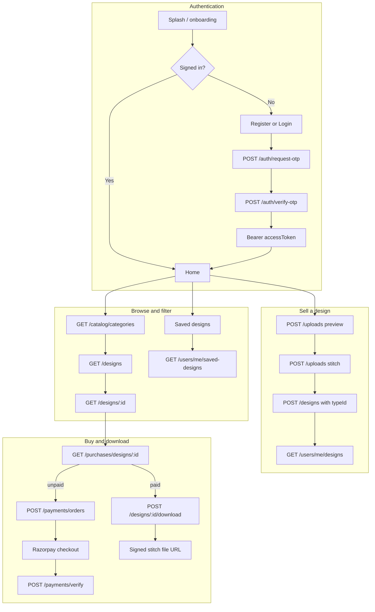
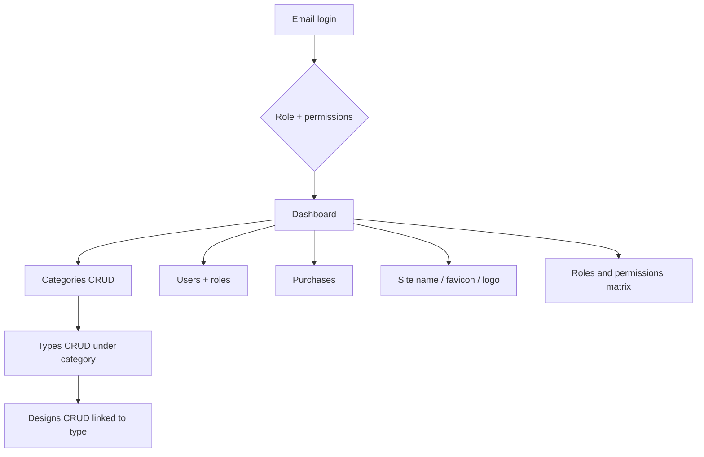
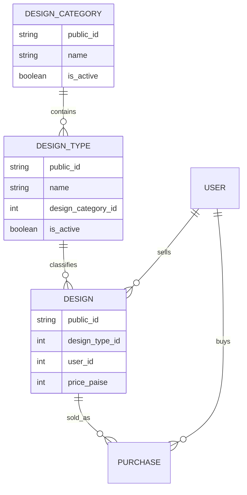

# DesignHub — system flow diagrams

## 1. Mobile app (marketplace) flow

## 2. Admin panel flow

## 3. Data model (category → type → design)

## 4. Catalog setup order (recommended)

1. Create **categories** (e.g. Hoop size, Color family, Design style).
2. Create **types** under each category (e.g. 6″ hoop under Hoop size).
3. When creating a **design** (admin or mobile API), set **`typeId`** to one type `public_id`.
4. Mobile app loads **`GET /api/v1/catalog/categories`** for filters and pickers.

## 5. API quick reference

| Area | Method | Path |
|------|--------|------|
| Catalog | GET | `/catalog/categories` |
| Design | POST/PATCH | `/designs` (body includes `typeId`) |
| Admin categories | Web | `/admin/categories` |
| Admin types | Web | `/admin/types` |

See also `docs/DesignHub-API.postman_collection.json` and `docs/mobile-handoff/BACKEND_HANDOFF.md`.
