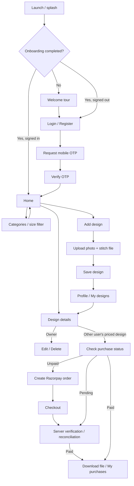

# DesignHub — App Flow & Backend API Handoff

Prepared: 3 October 2026. Based on the current mobile app source.

DesignHub is an embroidery design marketplace. A user signs in with a mobile OTP, browses designs, uploads their own designs with a price and stitch file, buys other users' designs through Razorpay, and downloads purchased files.

This document describes the APIs the frontend already expects and the additional integration needed for a complete production flow. Backend endpoints have not been verified against a running server.

## 1. App flow



| Screen / action | Current behavior | Backend interaction |
| --- | --- | --- |
| Splash / onboarding | Welcome preference stored on device | None |
| Register | Name, country code, mobile number → OTP | Request + verify OTP |
| Login | Country code, mobile number → OTP | Same endpoints, `flow: "login"` |
| OTP | Four digits; resend button after 30 seconds | Resend uses request-OTP endpoint again |
| Home | All designs; newest five in a horizontal, one-card-per-slide section | `GET /designs` |
| Home search / filters | Searches title, size, color and filename; filters size, color, photo/file and saved designs | Currently calculated locally from the full design array |
| Categories | Design sizes and matching design counts | Local constants + loaded designs; no categories API currently |
| Design details | Preview, title, size, color, price, attachment information | `GET /designs/:id` |
| Save / unsave | Heart button, saved collection | Currently in-memory only; proposed APIs below |
| Add design | Required photo, stitch file, title, size, color, INR price | Two uploads, then create design |
| Edit design | Only own design; reuse unchanged attachment URLs | Upload changed attachments, then patch design |
| Delete design | Owner confirmation | Delete design |
| Profile | User information, own designs, saved/purchased counts | Own designs API; counts currently local |
| Buy design | Other user's design with a valid price | Status → order → Razorpay → verify |
| My purchases / My files | Successful purchase entries stored on this device | No server purchase-list API wired yet |
| Download | Rechecks server purchase status, fetches detail, downloads `fileUri` | Existing status + detail APIs; protected delivery integration needed |
| Theme / logout | Theme preference on device; logout clears in-memory auth | No logout API wired |

The app gates marketplace screens behind login. Access token and login state are currently in memory; restarting the app requires signing in again. `GET /users/me` is defined in the service but is not currently used to restore a session.

## 2. Shared API conventions

- Base URL: set `EXPO_PUBLIC_API_URL`, for example `https://api.example.com/api/v1`. All paths below are relative to it.
- An empty URL enables demo mode. A configured URL enables API mode with no mock fallback on errors.
- Authenticated requests: `Authorization: Bearer <accessToken>`.
- JSON success envelope: `{ "data": ... }`. The frontend reads this exact shape.
- Error envelope: `{ "message": "Readable explanation" }` with an appropriate HTTP status.
- Successful JSON responses always contain `success`, `message`, and `data`; only paginated responses add `meta` and `links`. Errors contain `success: false`, a stable `code`, and `errors` only for field-level validation failures.
- Client timeout: 20 seconds. Handle retries safely, especially for uploads, creates and payments.
- Dates: ISO 8601 UTC strings. IDs: strings. Currency: INR; amounts are integer paise.
- Current list responses must be arrays inside `data`. Pagination requires frontend changes.
- An authenticated `401` logs the user out. Use `403` for a valid user lacking permission.
- Enable CORS for supported web origins, including JSON, Authorization and multipart uploads/downloads.

Example error:

```json
{ "message": "This OTP has expired. Request a new code." }
```

## 3. API inventory already defined in frontend

| Method | Endpoint | Auth | Purpose | Response `data` |
| --- | --- | --- | --- | --- |
| POST | `/auth/request-otp` | No | Send / resend OTP | `{ data: { message: "OTP sent successfully." } }` |
| POST | `/auth/verify-otp` | No | Verify OTP and sign in | `{ user, accessToken }` |
| GET | `/users/me` | Bearer | Fetch current user; service available | `User` |
| GET | `/designs` | Bearer | Community design list | `Design[]` |
| GET | `/users/me/designs` | Bearer | Own designs | `Design[]` |
| GET | `/designs/:id` | Bearer | Design details | `Design` |
| POST | `/uploads` | Bearer | Upload a single attachment | `{ url }` |
| POST | `/designs` | Bearer | Create own design | `Design` |
| PATCH | `/designs/:id` | Bearer | Update own design | `Design` |
| DELETE | `/designs/:id` | Bearer | Delete own design | `{ data: { message: "Design deleted successfully." } }` |
| GET | `/purchases/designs/:designId` | Bearer | Purchase status for current buyer | `PurchaseStatus` |
| POST | `/payments/orders` | Bearer | Create / reuse payment order | `CheckoutOrder` |
| POST | `/payments/verify` | Bearer | Verify payment proof | `PurchaseStatus` |

## 4. Authentication contract

### POST /auth/request-otp

```json
{
  "flow": "register",
  "name": "Example User",
  "countryCode": "+91",
  "mobileNumber": "9876543210"
}
```

Login sends `flow: "login"` and `name: null`. Verify sends the same fields plus `code: "1234"` to `POST /auth/verify-otp`.

Verification response:

```json
{
  "data": {
    "user": {
      "id": "user_001",
      "name": "Example User",
      "countryCode": "+91",
      "mobileNumber": "9876543210"
    },
    "accessToken": "<access-token>"
  }
}
```

`GET /users/me` returns `{ "data": <same user object> }`.

Backend requirements:

- Send real OTPs through the chosen SMS provider. Never use the demo's static OTP in API mode.
- Current UI accepts exactly four digits. A six-digit provider requires an app change.
- Bind the challenge to normalized phone number and flow; do not trust repeated client fields as proof of identity.
- Expire challenges, limit verification attempts and throttle OTP sends on the server. The 30-second client timer is only UI behavior.
- Registration name: trimmed, 2–40 characters. Current mobile validation accepts 7–15 digits; validate actual country-specific numbers on the server.
- Decide whether login for an unknown number and register for an existing number fail or redirect to the other flow; provide readable error messages.
- Consume successful OTPs once; avoid duplicate users with a unique normalized phone identity.

## 5. Design and upload contract

### Design request — POST /designs and PATCH /designs/:id

```json
{
  "title": "Floral neckline",
  "pricePaise": 29900,
  "size": "6″ hoop",
  "color": "Gold",
  "imageUri": "https://cdn.example.com/previews/photo.jpg",
  "fileName": "floral-neckline.dst",
  "fileUri": "https://api.example.com/files/file_001"
}
```

The file URL above illustrates the current field shape; paid files must remain protected. See section 7 before implementing delivery.

Response: `{ "data": <request fields plus the following> }`:

```json
{
  "id": "design_001",
  "createdAt": "2026-10-03T10:00:00.000Z",
  "ownerKey": "+919876543210"
}
```

All list/detail/create/update responses must supply the complete `Design` object:

```ts
type Design = {
  id: string;
  title: string;
  pricePaise: number | null;
  size: string;
  color: string;
  imageUri: string | null;
  fileName: string | null;
  fileUri: string | null;
  createdAt: string;
  ownerKey: string | null;
};
```

Validation and ownership:

- New/edited designs require a photo, stitch file, title, size, color and price.
- Title: trimmed, 1–40 characters. Size/color: nonempty strings; the form allows custom text.
- Price: integer `100..100000000` paise (₹1..₹10,00,000). Example: ₹299.99 → `29999`. Null legacy prices are not for sale.
- Suggested sizes: `4″ hoop`, `6″ hoop`, `8″ hoop`, `Saree border`, `Motif`.
- Suggested colors: Maroon, Gold, Ivory, Forest, Navy, Blush, Black, Copper.
- Derive owner from the Bearer token, never request data. Enforce ownership for PATCH/DELETE and own-design list.
- Existing UI uses `ownerKey = countryCode + mobileNumber` for ownership checks. `null` is reserved for shared samples. Store a stable user ID internally; replacing this phone-based compatibility field needs a frontend migration.
- Return community designs newest first. Home locally selects the latest five.
- Return 404 for missing designs. Preserve purchased file access when a seller removes a listing; agree on soft deletion/version retention before launch.

### POST /uploads

`multipart/form-data`, one field named `file`. Photo and stitch file are uploaded in separate requests before design creation/update.

```json
{ "data": { "url": "https://cdn.example.com/previews/photo.jpg" } }
```

The app reuses existing HTTP(S) attachment URLs on edit. Native stitch uploads use `application/octet-stream`; validate actual content/extension on the server. The current picker has no stitch-extension allowlist or size limit. Agree allowed formats and maximum photo/file sizes with the frontend team; enforce them server-side, with `413`/`415` and readable messages.

Preview images must be readable by the image component. Stitch files need private storage and authorized delivery. Do not accept arbitrary external URLs as trusted storage objects; validate upload ownership and accepted storage references. Clean up unattached uploads after failed saves.

## 6. Payment contract

### GET /purchases/designs/:designId

```json
{ "data": { "designId": "design_001", "status": "unpaid" } }
```

Statuses: `unpaid`, `pending`, `paid`. For a verified purchase, include `purchaseId`. No purchase returns `unpaid`, not 404. `pending` means a payment outcome needs confirmation; an order existing by itself must not leave the buyer blocked indefinitely.

### POST /payments/orders

Request: `{ "designId": "design_001" }`.

```json
{
  "data": {
    "designId": "design_001",
    "orderId": "order_example",
    "keyId": "rzp_test_example",
    "amount": 29900,
    "currency": "INR"
  }
}
```

Create Razorpay orders on the server. Read the current price from the database, reject own/unavailable/already-purchased designs, bind the order to buyer/design/amount/currency, and reuse safe existing unpaid orders on retries. Serialize competing requests per buyer/design and reconcile uncertain outcomes before allowing another payment.

### POST /payments/verify

```json
{
  "designId": "design_001",
  "razorpay_order_id": "order_example",
  "razorpay_payment_id": "pay_example",
  "razorpay_signature": "<signature>"
}
```

```json
{
  "data": {
    "designId": "design_001",
    "status": "paid",
    "purchaseId": "purchase_001"
  }
}
```

Verification must be idempotent. Match the stored order to the authenticated buyer/design, validate the checkout signature, and confirm the payment's order, amount, currency and captured status. An authentic payment awaiting capture returns `pending`. Record entitlement transactionally with unique payment IDs and buyer/design purchase constraints.

Server-created orders and server-side signature verification follow [Razorpay's official integration guide](https://razorpay.com/docs/payments/payment-gateway/web-integration/standard/integration-steps/). The app callback is never sufficient to grant a purchase.

### POST /payments/webhook — required server endpoint, not called by app

Configure this in Razorpay. Validate the raw-body signature with the webhook secret, deduplicate events, and reconcile captured/failed/refunded payments. Webhooks and a reconciliation job must recover payments when the app closes or verification requests fail. Define refund/access policy; the current purchase-status UI has no `refunded` status.

Keep Razorpay key secret, webhook secret and SMS credentials on the server. Only the public Razorpay Key ID is returned to the app. Keep test/live modes consistent. Seller settlement, commission and payouts are not implemented in the app and require a separate agreed business flow.

## 7. Additional APIs and frontend work

These are proposed additions, not existing API calls. Finalize names/shapes together before implementing them.

| Priority | Proposed endpoint | Purpose / suggested response | Frontend work |
| --- | --- | --- | --- |
| Required for paid-file delivery | `POST /designs/:id/download` | Check owner or verified buyer; return `{ data: { url, fileName, expiresAt } }` with a short-lived signed URL | Fetch delivery URL in download flow |
| Required for purchase recovery across devices | `GET /users/me/purchases` | Return `{ data: [{ id, design, amountPaise, currency, status, purchasedAt }] }`; define status values including refund handling | Replace device-only library/count with server purchases |
| Needed for saved-design sync | `GET /users/me/saved-designs` | `{ data: Design[] }` | Load server saved collection |
| Needed for saved-design sync | `PUT /users/me/saved-designs/:designId` | Save idempotently; JSON success response | Wire heart action |
| Needed for saved-design sync | `DELETE /users/me/saved-designs/:designId` | Unsave idempotently; JSON success response | Wire heart action |
| Optional persistent-session work | `POST /auth/refresh`, `POST /auth/logout` | Agree refresh-token/session contract and revocation | Secure token persistence + refresh/logout integration |
| Optional larger-catalog work | Query parameters on `GET /designs` | Search, size/color/reference filters, cursor/limit | Adapt services/store/UI for server filtering and pagination |
| Optional dynamic configuration | `GET /design-options` | Supported size/color options and upload limits | Replace local constants/config |

### Paid-file compatibility issue to resolve together

Currently, the Buy button treats a missing `fileUri` as “File unavailable”. After purchase, download rechecks status, loads design detail and downloads its `fileUri`. The file fetch does not attach the API Bearer token, so returning a protected URL that requires that token will not work with the existing downloader.

Do not return a permanently public stitch-file URL to solve this. Add a `hasFile` availability field for nonbuyers and use the proposed delivery endpoint to return a short-lived signed URL after authorization. Update the Buy button, types and downloader together. Public preview URLs may remain readable; paid stitch storage must stay private. Signed URLs are access-bearing and should not be stored in public catalog records.

An alternative compatible detail response can return a fresh signed `fileUri` only to authorized owners/buyers, but the nonbuyer availability check still needs a frontend change. Client-side purchase checks alone do not protect a public file URL.

My purchases is currently based on local payment history, not server entitlements. Webhook-only success or a purchase made on another device will not automatically appear there until the purchase-list API is integrated. Local test-preview entries must never grant server file access.

## 8. Suggested backend entities

- **User:** stable ID, normalized phone identity, name, created timestamp.
- **OTP challenge:** phone, flow, hashed code, expiry, attempts, consumed timestamp.
- **Upload:** ID, owner user ID, storage key, type, filename, bytes, attachment/cleanup status.
- **Design:** seller user ID, metadata, preview/stitch storage references, price paise, timestamps, listing/deletion state.
- **Payment order/attempt:** buyer, seller, design, Razorpay order/payment IDs, amount, currency, mode, processing status.
- **Purchase/entitlement:** buyer/design, captured payment, purchased file version, purchase/refund/access state.
- **Saved design:** unique user/design pair, saved timestamp.
- **Webhook event:** unique provider event ID, processing state and timestamp.

## 9. Acceptance checks for backend handoff

1. Register/login OTP works; wrong, expired, reused and rate-limited OTPs return readable errors.
2. Bearer authentication works; expired auth returns 401; another seller's edit/delete returns 403.
3. Upload photo + stitch file → create → list → detail → edit → delete works with agreed validation.
4. Responses use exact envelopes, integer paise, normalized ownerKey and ISO dates; empty lists return `data: []`.
5. Razorpay test-mode success, cancellation, failure, duplicate requests and pending capture behave correctly.
6. Invalid signatures, wrong buyer/order/amount and replayed webhooks cannot grant access or duplicate purchases.
7. Closing the app after payment and losing the verify response still recovers through server reconciliation.
8. Nonbuyers cannot access paid stitch files; verified buyers can download via expiring authorized delivery.
9. Purchase library survives app restart and works on a second device after the new API integration.
10. Deleted/edited listings and refunds follow the agreed purchased-file retention/access policy.

Backend developer should provide the staging base URL, OpenAPI or Postman collection, test users/OTP instructions, upload limits, error/status examples and Razorpay test integration configuration. Do not share production secrets in the app repository.

## 10. Source references

- [Current endpoint definitions](../src/api/endpoints.ts)
- [Auth, uploads and design services](../src/api/services.ts)
- [Payment services](../src/api/payments.ts)
- [Design types](../src/types/design.ts)
- [Payment state and retries](../src/store/paymentStore.ts)
- [Current download flow](../src/downloads/downloadDesign.ts)
- [Existing API integration notes](./API.md)
- [Detailed payment integration notes](./RAZORPAY.md)
